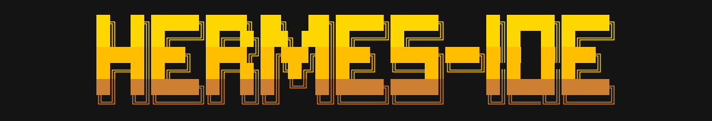

<p align="center">
  
</p>

# Hermes IDE ☤

**Hermes IDE is an opinionated, Hermes-based IDE.**

It started as a fork of [Hermes Agent](https://github.com/NousResearch/hermes-agent). It is no longer tracking it. We are stripping Hermes for parts.

## Divergence

<!-- divergence-badges:start -->
**hermes-ide**

  

- 57% of the original code is gone
- 23% of the code it has now is new
- 4.4 deleted per 1 added, 44% smaller

**upstream hermes**

  

- 16% of the original code is gone
- 40% of the code it has now is new
- 3.5 added per 1 deleted, 39% larger

Code means py/ts/tsx/js/jsx/mjs/cjs/css/scss/vue/rs/go/sh, not tests, compared with the last commit both trees still share.
<!-- divergence-badges:end -->

## What we're doing

Hermes is a good agent buried under a lot of code. Our goal is to remove the majority of it and end up with something that is:

- **Faster** — fewer layers between your message and the model.
- **Smarter** — a preconfigured, wheels-included agent that is useful on day one, not after a week of wiring.
- **Cheaper** — less prompt, fewer tokens, cache that stays warm.
- **Smaller** — one subsystem replaced at a time, deleted once its replacement works. Code that doesn't earn its place goes.

We keep the parts that work until their replacement is ready. We don't need a full rewrite to start improving it, and we don't pretend moved code is new code — substantial inherited implementation still exists today. The direction is an independent harness with none of it left.

## Opinions

- **Discord first.** Discord is the operator surface, not just another adapter. Your home server is mission control.
- **Code is delegated, not written in chat.** Coding lanes (Cursor, Claude Code) do the work; the agent plans, verifies, and publishes.
- **Delegated coding agents own the codebase.** They merge duplicates, fix related bugs, and keep adjacent cleanups in separate tested commits.
- **Batteries included.** Tooling, pipelines and integrations live in this tree. Upstream ships slim; we ship ready.
- **No upstream sync.** NousResearch/hermes-agent is ancestry, not an update source. Differences are intentional.

## Install

```bash
curl -fsSL https://raw.githubusercontent.com/QuixThe2nd/hermes-ide/main/scripts/install.sh | bash
```

Then `hermes setup`, make a Discord server for you and your bot, and run `/sethomeserver`.

## More

- [FEATURES.md](FEATURES.md) — the long version: every subsystem, flag and behaviour.
- [AGENTS.md](AGENTS.md) — how to work in this codebase.
- [Issues](https://github.com/QuixThe2nd/hermes-ide/issues)

## License

MIT — see [LICENSE](LICENSE). Built on the foundation laid by [Nous Research](https://nousresearch.com) and the Hermes contributors; their history, license and attribution notices are retained.
